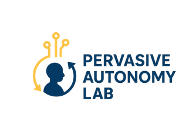
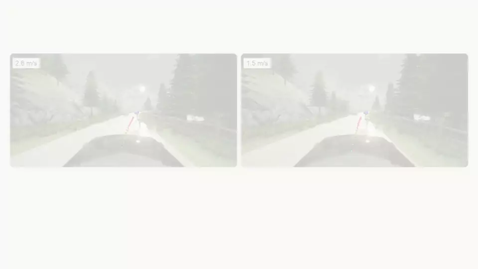
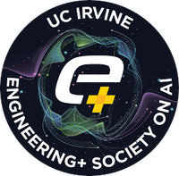

<div align="center">

<a href="https://faculty.sites.uci.edu/elmalaki/"></a>

# PersonaDrive

### Human-Style Retrieval-Augmented VLA Agents for Closed-Loop Driving Simulation

[Mahmoud Srewa](https://mosrewa.github.io/) · [Praneetsai Vasu Iddamsetty](https://www.linkedin.com/in/praneet-iddamsetty/) · [Mohammad Abdullah Al Faruque](https://aicps.eng.uci.edu/) · [Salma Elmalaki](https://faculty.sites.uci.edu/elmalaki/)

University of California, Irvine &nbsp;·&nbsp; **IEEE/CVF WACV 2027**

[](https://arxiv.org/abs/2606.12616)
[](https://pervasiveautonomylab.github.io/personadrive-landpage/)
[](https://huggingface.co/PervasiveAutonomyLab/PersonaDrive)
[](https://pervasiveautonomylab.github.io/personadrive-landpage/static/videos/demo_full.mp4)
[](https://huggingface.co/datasets/PervasiveAutonomyLab/PersonaDrive)
[](environment/README.md)
[](https://carla.org/)
[](LICENSE)

<a href="https://pervasiveautonomylab.github.io/personadrive-landpage/#demo"></a>

**A driving agent that drives carefully or aggressively, based on how real people drove.**<br>
<sub>Click the animation for the demo. Full-quality videos are on the <a href="https://pervasiveautonomylab.github.io/personadrive-landpage/">project page</a>.</sub>

</div>

---

PersonaDrive conditions a vision-language-action (VLA) driving agent on **demonstrations retrieved from people who were asked to drive in a given style**.
- **Dataset.** 15 participants drove CARLA Leaderboard routes on a driver-in-the-loop rig under *aggressive*, *neutral* and *conservative* instructions.
- **Retrieval.** A lightweight retrieval head embeds what the car *sees* (the front-camera image) together with what it is *doing* (speed, throttle, steering, brake and the navigation command). Searching the selected style's database with this embedding finds moments where people driving in that style faced a similar scene in a similar state.
- **Prediction.** The VLA backbone reads those moments as in-context demonstrations before predicting its own waypoints.

**Changing the style changes which database is searched, so one set of weights serves every style.**

<table>
<tr>
<td align="center" width="33%"><b>A controlled style dataset</b><br><sub>15 drivers × 3 instructed styles, paired at the route level so style is decoupled from driver identity. <b>29,777 frames</b>, 55 routes and 21 scenario types.</sub></td>
<td align="center" width="33%"><b>Style from retrieved humans</b><br><sub>Triplet mining → retrieval head over per-style databases → in-context fine-tuning. No style tokens, proxy rewards or per-style models are needed, because switching style is a <b>database swap</b>.</sub></td>
<td align="center" width="33%"><b>Strong closed-loop driving</b><br><sub>Bench2Drive Driving Score <b>88.95</b> without style (+4.6 % over SimLingo). With style, it scores <b>87.55–89.62</b> in every style, while speed and acceleration rise <b>19.8 %</b> and <b>24.9 %</b> from conservative to aggressive.</sub></td>
</tr>
</table>

Demos, how the method works, the dataset and the results are in **[More information](more_info/README.md)**.

## Contents

1. [Repository layout](#repository-layout)
2. [Installation](#installation)
3. [Data and released artefacts](#data-and-released-artefacts)
4. [Quick start with the released model](#quick-start-with-the-released-model)
5. [Evaluation](#evaluation)
6. [The `normal` index and the SimLingo checkpoint (optional)](#the-normal-index-and-the-simlingo-checkpoint-optional)
7. [Full pipeline](#full-pipeline)
8. [What is (not) in this repository](#what-is-not-in-this-repository)
9. [Citation](#citation)

See also [More information](more_info/README.md) (demos, method, dataset, results) · [Evaluation and the paper's tables](evaluation/README.md) · [Verification and troubleshooting](troubleshooting/README.md)

## Repository layout

```
PersonaDrive/
├── persona_drive_rag/      Stages 1–2 code: frame sentences, embeddings, triplet mining, retrieval head, FAISS indices
├── simlingo_training/      Stage 3: the VLA backbone, ICL prompt prefix, online retriever, training configs
├── team_code/              CARLA agents (PersonaDrive agent: team_code/agent_simlingo.py; PDM-lite expert)
├── scripts/
│   ├── setup/              setup_carla.sh, carla_exports.sh
│   ├── retrieval/          run_stage1_mining.sh → train_retrieval_head.sh → build_style_indices.sh   (Stages 1–2)
│   ├── training/           run_icl_local.sh + generate_icl_examples.py (Stage 3a), train_simlingo_seed1.sh (baseline)
│   ├── eval/               Bench2Drive: test_one_lb1_route.sh, start_eval_simlingo.py, run_*_profiles.sh, aggregate_b2d_metrics*.py
│   ├── analysis/           open-loop experiments: style probes, ADE/FDE and QA vs K, latency
│   ├── data_collection/    PDM-lite data agent runs on SLURM
│   └── data_processing/    raw recordings → labelled, aggregated dataset (run_pipeline.py, records_integrating.py, …)
├── datasets/               dataset documentation and a drop zone for new recordings
├── human_data_collection/  driver-in-the-loop recording rig (wheel + pedals), label generation, conversion to the dataset layout
├── environment/            conda envs: *.yaml (conda layer), requirements-*.txt (pip pins), setup_env.sh
├── tests/                  static checks, mini dataset, end-to-end smoke test, retrieval / LoRA / eval tests
├── evaluation/             full Bench2Drive evaluation and the scripts behind the paper's tables
├── more_info/              demos, method, dataset and results
├── troubleshooting/        installation checks and common problems
├── assets/                 README figures and animations
└── Bench2Drive/, leaderboard*/, scenario_runner*/, dataset_generation/, data/, tools/
                            inherited from SimLingo / CARLA garage (benchmark harness, expert, label generators, route files)
```

## Installation

**1. Clone and set up CARLA 0.9.15.** `scripts/setup/setup_carla.sh` installs CARLA into `software/carla0915`.

```bash
git clone https://github.com/PervasiveAutonomyLab/PersonaDrive.git
cd PersonaDrive
bash scripts/setup/setup_carla.sh
```

**2. Create the conda environment.** One environment runs every stage, the CARLA agent and evaluation. The installer ends with an import self-check.

```bash
bash environment/setup_env.sh -n personadrive          # or -p /path/to/prefix
conda activate personadrive
```

Package versions, the manual install and the flash-attention options are in [environment/README.md](environment/README.md).

**3. Configure paths.** Every machine-specific path is read from environment variables.

```bash
cp .env.example .env        # then edit: PERSONADRIVE_ROOT, PERSONADRIVE_DATA_ROOT, CARLA_ROOT,
                            #            PERSONADRIVE_CONDA_ENV, ...
set -a; source .env; set +a
export PYTHONPATH="${CARLA_ROOT}/PythonAPI/carla:${PERSONADRIVE_ROOT}:${PYTHONPATH:-}"
```

`.env.example` documents every variable and its default.

## Data and released artefacts

| What | Where | Size |
|---|---|---:|
| PersonaDrive model (Stage 3) | Hugging Face model [PervasiveAutonomyLab/PersonaDrive](https://huggingface.co/PervasiveAutonomyLab/PersonaDrive) | 1.96 GB |
| Style dataset with `default` (neutral), `fast` (aggressive) and `slow` (conservative) | Hugging Face dataset [PervasiveAutonomyLab/PersonaDrive](https://huggingface.co/datasets/PervasiveAutonomyLab/PersonaDrive), one zip per style plus the annotations | 32.9 GB |
| Retrieval head (Stage 2) | `persona_drive_rag/checkpoints/best_model.pt` | 24 MB |
| Per-style FAISS indices | built from the dataset with the retrieval head (step 3 below) | — |
| `normal` (no-style) index, vectors and frame list | Hugging Face model [PervasiveAutonomyLab/PersonaDrive](https://huggingface.co/PervasiveAutonomyLab/PersonaDrive), `retrieval/normal/`, completed from your SimLingo download ([optional](#the-normal-index-and-the-simlingo-checkpoint-optional)) | 0.2 GB |
| Data-collection code (driver-in-the-loop rig) | [`human_data_collection/`](human_data_collection/README.md) | — |
| SimLingo checkpoint (Stage-3 initialisation) and PDM-lite data | upstream, from the SimLingo authors ([`RenzKa/simlingo`](https://huggingface.co/RenzKa/simlingo)) | — |

[datasets/README.md](datasets/README.md) has the dataset layout, the profile ↔ style mapping and how to add newly collected driving data.

### 1. Download the model

```bash
hf download PervasiveAutonomyLab/PersonaDrive --local-dir pretrained \
    --include "config.json" "personadrive_icl_sft/.hydra/*" "personadrive_icl_sft/checkpoints/epoch=000.ckpt/*"
export PERSONADRIVE_CKPT=$PWD/pretrained/personadrive_icl_sft/checkpoints/epoch=000.ckpt/pytorch_model.pt
```

- **What it is.** The complete Stage-3 model in one file, with SimLingo's frozen weights plus the trained LoRA adapters and heads and the `.hydra/` config of its run.
- **Loading.** It loads directly, with no DeepSpeed consolidation.
- **Who reads it.** Every evaluation and analysis script reads `PERSONADRIVE_CKPT`.

### 2. Download the dataset

```bash
export PERSONADRIVE_DATA_ROOT=/path/to/personadrive_data          # will contain simlingo/
hf download PervasiveAutonomyLab/PersonaDrive --repo-type dataset --local-dir downloads/personadrive_data
for z in downloads/personadrive_data/*.zip; do unzip -q "$z" -d "$PERSONADRIVE_DATA_ROOT"; done
```

To evaluate a single style, `data_<style>.zip`, `commentary.zip` and `drivelm.zip` are enough. For example, this downloads only the neutral style.

```bash
hf download PervasiveAutonomyLab/PersonaDrive data_default.zip commentary.zip drivelm.zip \
    --repo-type dataset --local-dir downloads/personadrive_data
```

### 3. Build the retrieval indices

At every tick, the agent searches the FAISS index of the selected style and opens the camera frames of the retrieved demonstrations. This step prepares those indices in two parts.

- **3a. Mine the frames (Stage 1).** Every 5th frame of each style becomes a structured sentence, and its image is embedded with SigLIP and the sentence with BGE-M3.
- **3b. Build the style indices.** The released retrieval head embeds the frames, and one FAISS index is built per style (`default`, `fast`, `slow`).

The style-agnostic `normal` index and the SimLingo checkpoint (needed only for training) are optional. They are described in [The `normal` index and the SimLingo checkpoint](#the-normal-index-and-the-simlingo-checkpoint-optional).

Run **3a and 3b** on one GPU.

```bash
conda activate personadrive
# frame sentences (stride 5) + SigLIP image / BGE-M3 text embeddings, per style
bash scripts/retrieval/run_stage1_mining.sh default fast slow
# one FAISS index per style, embedded with the released retrieval head
bash scripts/retrieval/build_style_indices.sh --checkpoint persona_drive_rag/checkpoints/best_model.pt default fast slow
```

- **Outputs.** `persona_drive_rag/{processed_routes,embeddings_v2,triplets_v2,faiss_index}/<style>/`. The agent's defaults `PERSONADRIVE_ICL_ROOT=persona_drive_rag` and `PERSONADRIVE_ICL_CKPT=persona_drive_rag/checkpoints/best_model.pt` point there.
- **Model cache.** The embedding models are downloaded into `PERSONADRIVE_HF_CACHE` if it is set, otherwise into Hugging Face's default cache (`$HF_HOME`, else `~/.cache/huggingface`).
- **Time.** On one L40S, Stage 1 and the index for `default` (1,455 frames at stride 5) take about 10 minutes, while `fast` and `slow` have more frames and take longer.

InternVL2-1B (`OpenGVLab/InternVL2-1B`), SigLIP (`google/siglip-base-patch16-224`) and BGE-M3 (`BAAI/bge-m3`) are downloaded from Hugging Face on first use.

## Quick start with the released model

With the model downloaded, the dataset extracted and the style indices built (steps 1–3 above), and the `personadrive` env active, drive one route.

```bash
# one Bench2Drive route on one GPU, neutral driving style, K = 2; writes PNGs, telemetry and an MP4 of the run
PERSONADRIVE_ICL_PROFILE=default \
ROUTE_XML=$PERSONADRIVE_ROOT/leaderboard/data/bench2drive_split/bench2drive_00.xml \
OUT_DIR=/tmp/personadrive_route00 \
bash scripts/eval/test_one_lb1_route.sh
```

- **Styles.** Switching style only changes `PERSONADRIVE_ICL_PROFILE`, which can be `default` (neutral), `fast` (aggressive), `slow` (conservative) or `normal` (style-agnostic, which needs the [optional `normal` index](#the-normal-index-and-the-simlingo-checkpoint-optional)).
- **CARLA.** The Bench2Drive evaluator starts its own CARLA server from `CARLA_ROOT`. Do not start one yourself (`scripts/eval/start_carla.sh` is only for debugging CARLA in isolation).
- **Inputs**
  - The script reads `AGENT_CKPT`, which defaults to `${PERSONADRIVE_CKPT}` or the released model from step 1 (`pretrained/personadrive_icl_sft/checkpoints/epoch=000.ckpt/pytorch_model.pt`).
  - It also reads `PERSONADRIVE_ICL_PROFILE`, `PERSONADRIVE_ICL_ROOT` and `PERSONADRIVE_NUM_ICL` (0 disables retrieval).
- **Keep `PERSONADRIVE_DATA_ROOT` set.** The agent loads the retrieved frames from it. Frames it cannot find are skipped, and if it finds none, it drives without retrieval.
- **Outputs.** Without `OUT_DIR`, results go to `eval_results/single_route/<route>/<timestamp>/`.

If a step fails, see [Verification and troubleshooting](troubleshooting/README.md).

## Evaluation

To check the released model on a few routes, drive the same Bench2Drive routes in each style, one after another on one GPU (each route takes about 10–20 minutes on an L40S).

```bash
for style in default fast slow; do
  for r in 00 01 02; do
    PERSONADRIVE_ICL_PROFILE=$style \
    ROUTE_XML=$PERSONADRIVE_ROOT/leaderboard/data/bench2drive_split/bench2drive_${r}.xml \
    OUT_DIR=eval_results/few_routes/${style}/bench2drive_${r} \
    bash scripts/eval/test_one_lb1_route.sh
  done
done
# Driving Score of each style and route
python -c "import glob, json; [print('/'.join(f.split('/')[-4:-2]), r['scores']['score_composed']) for f in sorted(glob.glob('eval_results/few_routes/*/*/res/result.json')) for r in json.load(open(f))['_checkpoint']['records']]"
```

- **Routes and styles.** Any of the 220 routes in `leaderboard/data/bench2drive_split/` (`bench2drive_00.xml` to `bench2drive_219.xml`) can be used. Add `normal` to the style list once its [optional index](#the-normal-index-and-the-simlingo-checkpoint-optional) is built.
- **Full evaluation.** The 220-route Bench2Drive evaluation of every condition, the open-loop and latency measurements, and the script that prints every table of the paper are in **[Evaluation and the paper's tables](evaluation/README.md)**.

## The `normal` index and the SimLingo checkpoint (optional)

**The `normal` (style-agnostic) index** is needed for the `normal` profile (the paper's Tables 1 and 2) and for Stage 3a. It retrieves from a slice of the SimLingo dataset (PDM-lite autopilot data, 54,040 frames). The SimLingo licence does not allow redistributing that data, so the release holds the index's vectors and frame list, and you complete it from your own SimLingo download in two steps.
1. Download the SimLingo splits `training_1_scenario`, `training_3_scenarios` and `lb1_split` (data and commentary, about 550 GB) and extract them under `$PERSONADRIVE_DATA_ROOT` (see [datasets/README.md](datasets/README.md)).
2. Download the index and complete it.

```bash
hf download PervasiveAutonomyLab/PersonaDrive --include "retrieval/normal/*" --local-dir downloads/personadrive_model
python scripts/retrieval/fill_normal_index.py --release downloads/personadrive_model/retrieval/normal \
    --out persona_drive_rag/faiss_index/normal
```

To build a `normal` index of your own instead, run `bash scripts/retrieval/run_stage1_mining.sh normal`, then `bash scripts/retrieval/build_style_indices.sh --checkpoint persona_drive_rag/checkpoints/best_model.pt normal`. It mines `training_1_scenario` at stride 5.

**The SimLingo checkpoint** is needed only to fine-tune Stage 3 yourself, because Stage 3 starts from it. Download it to the path the config expects.

```bash
hf download RenzKa/simlingo simlingo/checkpoints/epoch=013.ckpt/pytorch_model.pt simlingo/.hydra/config.yaml \
    --local-dir pretrained/RenzKa_simlingo
```

## Full pipeline

Each stage has one entry point. Per-stage details, file formats and provenance are in [persona_drive_rag/README.md](persona_drive_rag/README.md).

### Stages 1–2 – triplet mining, retrieval head, style indices (`personadrive` env, 1 GPU)

Anyone can train the retrieval head with three scripts. Each one reads and writes `PERSONADRIVE_ICL_ROOT`, which defaults to `persona_drive_rag/`, and skips work that already exists unless `FORCE=1`.

```bash
conda activate personadrive

# Stage 1: structured frame sentences (stride 5) → SigLIP + BGE-M3 embeddings → triplets, per style
bash scripts/retrieval/run_stage1_mining.sh                     # default fast slow  (add `normal` for PDM-lite)

# Stage 2: train the retrieval head, pooled over every profile found
bash scripts/retrieval/train_retrieval_head.sh                  # -> persona_drive_rag/checkpoints/head_paper/best_model.pt

# Stage 2b: one FAISS index per style, built with that head
bash scripts/retrieval/build_style_indices.sh --checkpoint persona_drive_rag/checkpoints/head_paper/best_model.pt
export PERSONADRIVE_ICL_CKPT=$PERSONADRIVE_ROOT/persona_drive_rag/checkpoints/head_paper/best_model.pt   # use it downstream
```

Stage 1 needs the style dataset (and PDM-lite for `normal`), see [Data and released artefacts](#data-and-released-artefacts). `train_retrieval_head.sh` trains on the triplets of every profile found under `PERSONADRIVE_ICL_ROOT`, with a weighted triplet loss (margin 0.3, hard-negative weight 2.0, AdamW, lr 1e-4, weight decay 0.01, batch 128, 20 epochs).

**Which head to use.** The released head `persona_drive_rag/checkpoints/best_model.pt` built every released index and context point, so use it with the released indices and checkpoint. If you train your own head, use it consistently. Rebuild the indices with it, re-run Stage 3a with `PERSONADRIVE_ICL_CKPT` pointing at it, and fine-tune Stage 3 on those context points.

Extra arguments are passed through to `persona_drive_rag/embed_training.py`, for example `--epochs 5` or `--name my_head`. The exact per-profile commands that produced the released artefacts, including the PDM-lite pivot pipeline for the `normal` index, are in [persona_drive_rag/README.md](persona_drive_rag/README.md#commands-that-produced-the-shipped-artefacts).

### Stage 3a – precompute retrieved context points (`personadrive` env, 1 GPU)

```bash
conda activate personadrive
cd "$PERSONADRIVE_ROOT"
bash scripts/training/run_icl_local.sh            # normal -> PDM-lite routes, slow/fast -> {slow,fast}/lb1_split; add --overwrite to redo
# uses PERSONADRIVE_ICL_ROOT (indices) and PERSONADRIVE_ICL_CKPT (head); default: the released ones
```

This writes `icl_examples.json.gz` (K = 2 context points per frame, from the matching style index) next to each route's `measurements.json`. It reads `PERSONADRIVE_DATA_ROOT` and `PERSONADRIVE_ICL_ROOT` (default `persona_drive_rag/`). The `lb1_split` routes in the Hugging Face dataset already contain them.

### Stage 3b – in-context fine-tuning of the backbone (`personadrive` env)

```bash
ln -s "${PERSONADRIVE_DATA_ROOT%%:*}" database       # data_path in the config is relative to the repo root
python simlingo_training/train.py experiment=personadrive_icl_sft
```

`personadrive_icl_sft` is the configuration of the run that produced the [released checkpoint](https://huggingface.co/PervasiveAutonomyLab/PersonaDrive) (a verbatim copy of `experiment/debug.yaml`).

| Setting | Value |
|---|---|
| Initialisation | SimLingo `epoch=013` (`pretrained/RenzKa_simlingo/...`, [download](#the-normal-index-and-the-simlingo-checkpoint-optional)) |
| Trainable | LoRA on the language model (r = 32, α = 64, dropout 0.1), the vision-to-language projector, the driving adaptor and the waypoint encoder, with the vision encoder frozen |
| Optimiser / lr | AdamW, 3e-5 (OneCycle, `pct_start` 0.05, weight decay 0.1) |
| Batch | 6 per GPU × 4 GPUs, DeepSpeed ZeRO-2, bf16 |
| Epochs | 1, with validation every 0.25 epoch and the top-2 checkpoints kept by `val/loss` |
| K | 2 retrieved context points (`num_icl_examples`) |
| Data | All three styles, neutral (`default`), aggressive (350 `fast/lb1_split` routes) and conservative (350 `slow/lb1_split` routes), plus 2,848 PDM-lite routes, with a route-level split into training and validation |
| Hardware / time | 4× NVIDIA L40S (48 GB), ≈ 12 h |
| Smaller GPUs | Batch 6 per GPU needs a 48 GB GPU. On 24 GB GPUs (A30), keep the same effective batch with `data_module.batch_size=2 accumulate_grad_batches=3`. |

Training logs to Weights & Biases (`debug=True` switches it to offline).

## What is (not) in this repository

**Included**
- All code for Stages 1–3, the CARLA agent and evaluation.
- The two retrieval heads (24 MB each), with provenance of the runs that produced the released indices.
- Route files and CARLA map assets.
- The data-collection rig code ([human_data_collection/](human_data_collection/README.md)).
- Environment captures and tests.

**Released separately**
- The style dataset, on Hugging Face ([PervasiveAutonomyLab/PersonaDrive](https://huggingface.co/datasets/PervasiveAutonomyLab/PersonaDrive), dataset).
- The Stage-3 checkpoint, on Hugging Face ([PervasiveAutonomyLab/PersonaDrive](https://huggingface.co/PervasiveAutonomyLab/PersonaDrive), model).

**Not included**
- CARLA itself.
- Upstream model weights (Hugging Face).
- The upstream PDM-lite dataset.

## Acknowledgements

<p align="center">
<a href="https://faculty.sites.uci.edu/elmalaki/"></a>&nbsp;&nbsp;&nbsp;&nbsp;
<a href="https://www.nsf.gov/"></a>&nbsp;&nbsp;&nbsp;&nbsp;

</p>

This work is supported by the U.S. National Science Foundation under grant 2339266 and partially supported by the UCI ProperAI Institute. PersonaDrive builds directly on SimLingo, CARLA garage, DriveLM / PDM-Lite and Bench2Drive, and we thank their authors for releasing their code. The project page design is adapted from [Nerfies](https://github.com/nerfies/nerfies.github.io).

## Citation

```bibtex
@inproceedings{srewa2027personadrive,
  title     = {PersonaDrive: Human-Style Retrieval-Augmented VLA Agents for Closed-Loop Driving Simulation},
  author    = {Srewa, Mahmoud and Iddamsetty, Praneetsai Vasu and Al Faruque, Mohammad Abdullah and Elmalaki, Salma},
  booktitle = {Proceedings of the IEEE/CVF Winter Conference on Applications of Computer Vision (WACV)},
  year      = {2027}
}
```

Please also cite the works this code builds on.

```bibtex
@InProceedings{Renz2025cvpr,
  title     = {SimLingo: Vision-Only Closed-Loop Autonomous Driving with Language-Action Alignment},
  author    = {Renz, Katrin and Chen, Long and Arani, Elahe and Sinavski, Oleg},
  booktitle = {Conference on Computer Vision and Pattern Recognition (CVPR)},
  year      = {2025}
}
@inproceedings{Sima2024ECCV,
  title     = {DriveLM: Driving with Graph Visual Question Answering},
  author    = {Chonghao Sima and Katrin Renz and Kashyap Chitta and Li Chen and Hanxue Zhang and Chengen Xie and Jens Beißwenger and Ping Luo and Andreas Geiger and Hongyang Li},
  booktitle = {Proc. of the European Conf. on Computer Vision (ECCV)},
  year      = {2024}
}
@inproceedings{Jia2024NeurIPS,
  title     = {Bench2Drive: Towards Multi-Ability Benchmarking of Closed-Loop End-To-End Autonomous Driving},
  author    = {Xiaosong Jia and Zhenjie Yang and Qifeng Li and Zhiyuan Zhang and Junchi Yan},
  booktitle = {NeurIPS 2024 Datasets and Benchmarks Track},
  year      = {2024}
}
```

## License

The code is released under the Apache 2.0 [LICENSE](LICENSE) inherited from SimLingo. [LICENCE_Dataset](LICENCE_Dataset) is SimLingo's licence for the upstream PDM-lite dataset.

The human driving data behind PersonaDrive's driving styles was collected by us and is released as the [PersonaDrive dataset](https://huggingface.co/datasets/PervasiveAutonomyLab/PersonaDrive). SimLingo's PDM-lite data was used to train the SimLingo base model, for part of the Stage-3 fine-tuning data and for the style-agnostic `normal` index, and its licence asks for the attribution below.

<sub>This work was made using the SimLingo dataset, provided by Wayve Technologies Ltd under licence terms available at https://github.com/RenzKa/simlingo.</sub>
